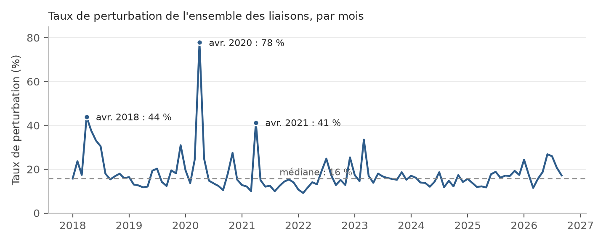
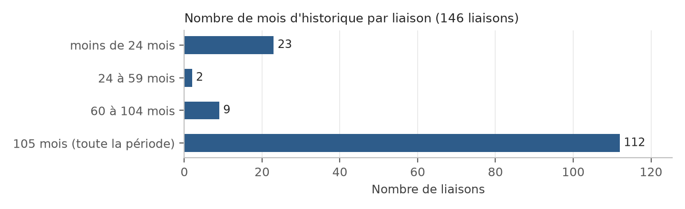

# Datasheet pour la Régularité mensuelle TGV par liaisons (SNCF)

> Version : 1.1 | Date : 2026-11-20 | Auteur(s) : équipe projet SNCF 2026 — Amy KANE, Aristide MAWUENA RUKUNDO, Machoudi ADEGOUNTE, Matthieu BAUCHER

Cette fiche décrit le fichier 'regularite-mensuelle-tgv-aqst.csv' tel qu'il est utilisé dans le projet.

**Source.** Les données sont collectées et publiées par SNCF Voyageurs, sur son portail open data (<https://ressources.data.sncf.com/explore/dataset/regularite-mensuelle-tgv-aqst/>).

## 1. Motivation

Ce jeu de données publie, pour chaque liaison TGV et chaque mois, le nombre de trains prévus, annulés et en retard, l'ampleur des retards et la part de chaque cause de retard. Il a été créé et est édité par SNCF Voyageurs, et il porte la mention AQST (Autorité de la qualité de service dans les transports). La source n'indique pas de financement particulier. Notre projet, lui, n'est pas financé : il est purement académique.

Son usage prévu est d'informer le public sur la régularité des TGV et de comparer les liaisons dans le temps. Dans notre projet, il sert de base à un outil d'aide à la décision pour un assureur, et chaque membre de l'équipe l'utilise pour une partie de cet outil (tableau 1).

**Tableau 1 – Usages du jeu de données dans le projet**

| Partie | Ce qui est calculé |
|---|---|
| Analyse des retards et score de fiabilité | score de fiabilité par liaison, régularité, saisonnalité, cause dominante, mois de choc national, niveau de confiance ; carte de fiabilité |
| Analyses descriptives | variations mensuelles des retards et des annulations, heatmap de saisonnalité, évolution des causes, classement des pires trajets |
| Simulation des retards par axe | modèle de retard par axe, simulation de scénarios |
| Nettoyage et prévision | nettoyage commun des données, prévision « Normal / Perturbé » du mois suivant par liaison |

La source déconseille d'additionner les liaisons pour calculer une régularité globale ou par axe, car un même TGV peut compter dans plusieurs liaisons. Comme les données sont mensuelles et agrégées, elles ne permettent pas non plus de juger un train, un jour ou une personne.

La SNCF publie aussi la régularité mensuelle TGV globale et par axe. Nous ne les utilisons pas comme base, car elles ne tiennent pas compte de la liaison, qui est l'échelle utile pour un assureur. D'autres jeux complètent ce fichier : un fichier de régularité nationale des TGV, pour situer le contexte dans la partie exploration, et, pour la carte de fiabilité, le jeu « Gares de voyageurs » (coordonnées des gares) et le « Fichier de formes des lignes du Réseau Ferré National » de SNCF Réseau.

## 2. Composition

Chaque ligne du fichier correspond à une liaison TGV pendant un mois. Une liaison est définie par sa gare de départ, sa gare d'arrivée et son service (National ou International). Le tableau 2 donne la taille du jeu de données.

**Tableau 2 – Chiffres clés de la version utilisée**

| Élément | Valeur |
|---|---|
| Lignes | 12 907 |
| Colonnes | 26 |
| Période | janvier 2018 à septembre 2026 (105 mois) |
| Liaisons | 146 |
| Gares | 59 |
| Lignes du service national | 11 339 (88 %) |
| Lignes du service international | 1 568 (12 %) |

Les 26 colonnes se répartissent en sept groupes (tableau 3). D'après son nom, le retard moyen des trains en retard de plus de 15 minutes n'est renseigné que pour les liaisons concurrencées par l'avion.

**Tableau 3 – Les colonnes du fichier**

| Groupe | Colonnes | Type |
|---|---|---|
| Identifiants | mois, service, gare de départ, gare d'arrivée | texte |
| Volume | durée moyenne du trajet, circulations prévues, trains annulés | nombre |
| Retards au départ | trains en retard, retard moyen des trains en retard, retard moyen de tous les trains | nombre, minutes |
| Retards à l'arrivée | trains en retard, retard moyen des trains en retard, retard moyen de tous les trains | nombre, minutes |
| Gravité | trains en retard de plus de 15, 30 et 60 min ; retard moyen des trains en retard de plus de 15 min | nombre, minutes |
| Causes (6 colonnes) | causes externes, infrastructure, gestion du trafic, matériel roulant, gestion en gare et réutilisation de matériel, prise en compte des voyageurs | pourcentage |
| Commentaires | annulations, retards au départ, retards à l'arrivée | texte libre |

Le jeu ne contient pas de label : chaque partie du projet construit ses propres indicateurs à partir des colonnes. L'indicateur commun est le taux de perturbation :

$$\tau = \frac{\text{trains annulés} + \text{trains en retard à l'arrivée}}{\text{circulations prévues}}$$

Le score de fiabilité vaut $100 \times (1 - \tau)$, calculé sur toute la période ; il est complété par la régularité, la saisonnalité, la cause dominante et un niveau de confiance (« peu fiable » sous 24 mois), et les liaisons sont réparties en trois niveaux de fiabilité. La prévision du mois suivant classe un mois « Perturbé » quand $\tau$ dépasse 20 %. La simulation des retards par axe prend comme cibles le retard moyen à l'arrivée, la part de trains en retard de plus de 30 minutes et la part d'annulations. Les analyses descriptives n'ont pas de cible : elles décrivent directement les colonnes.

Deux colonnes de commentaires sont entièrement vides et la troisième est vide sur 12 209 lignes. Les colonnes chiffrées n'ont pas de valeur vide, mais certaines valeurs sont impossibles. Sur 272 lignes, les six pourcentages de causes valent tous zéro, dont les 73 lignes sans circulation : la cause des retards n'est alors pas renseignée.

Le jeu ne contient aucune information personnelle ou sensible : il n'y a ni voyageur, ni agent, ni numéro de train.

Sur le plan géographique, les gares sont situées en France et, pour les liaisons internationales, dans des pays voisins. Sur le plan temporel, chaque mois de la période est présent, avec 1 446 à 1 560 lignes par année complète. La période comprend des mois exceptionnels, comme le confinement de 2020 et des grèves. La figure 1 montre le poids de ces mois dans l'ensemble des liaisons.

*Figure 1 – Taux de perturbation, toutes liaisons confondues*

Aucune ligne n'est répétée, et aucune combinaison mois, gare de départ, gare d'arrivée et service n'apparaît deux fois. En revanche, de juillet à septembre 2025, 14 liaisons apparaissent à la fois en National et en International, soit 42 lignes. C'est pour cette raison que le service fait partie de la définition d'une liaison.

## 3. Processus de collecte

Selon la source, les horaires d'arrivée sont mesurés par des capteurs qui détectent le passage du train à l'entrée en gare, et exceptionnellement par un suivi manuel. Les retards sont arrondis à la minute inférieure.

Les données sont produites par SNCF Voyageurs avec ses systèmes de suivi des circulations ; notre équipe s'est contentée de télécharger le fichier CSV publié. La dernière mise à jour de la source date du 2 octobre 2026, et la version utilisée contient les données jusqu'à septembre 2026.

La question de la rémunération des collecteurs ne se pose pas, car la collecte est automatique. Celles du consentement et de la vie privée ne se posent pas non plus, car les données sont agrégées par liaison et par mois avant publication et ne décrivent aucune personne.

## 4. Prétraitement, nettoyage et labellisation

Le nettoyage commun est réalisé par la fonction "nettoyer", appelée par "get_dataframe", la fonction de chargement partagée de l'application. Chaque règle est justifiée dans le notebook "02_exploration_nettoyage.ipynb". Le principe est de garder les lignes et de remplacer une valeur impossible par une valeur manquante, pour ne pas perdre les autres informations du mois. Le tableau 4 détaille les règles. Au total, le fichier passe de 12 907 à 12 834 lignes, et 656 cases deviennent manquantes.

**Tableau 4 – Règles de nettoyage**

| Problème | Traitement | Effet |
|---|---|---|
| Colonnes de commentaires (texte libre, presque vides) | colonnes supprimées | 3 colonnes |
| Aucune circulation prévue | ligne supprimée | 73 lignes, dont 50 en avril 2020 |
| Trains en retard de plus de 30 min négatif, ou inférieur à ceux de plus de 60 min | valeur « plus de 30 min » mise à manquant | 354 cases |
| Retard moyen de tous les trains au départ négatif | valeur mise à manquant | 170 cases |
| Retard moyen de tous les trains à l'arrivée négatif | valeur mise à manquant | 122 cases |
| Retard moyen des trains en retard de plus de 15 min négatif | valeur mise à manquant | 8 cases |
| Retard moyen des trains en retard à l'arrivée négatif | valeur mise à manquant | 2 cases |

Les indicateurs sont calculés automatiquement à partir des colonnes. Il n'y a pas d'annotation manuelle, donc pas de taux d'accord inter-annotateurs. Les mois de choc national, comme les grèves ou le confinement, ne sont pas indiqués dans le CSV : le projet les repère automatiquement, à partir de l'écart du taux de perturbation national à sa médiane. Ils sont écartés du calcul de la saisonnalité et de la régularité, ainsi que de l'apprentissage de la prévision du mois suivant, mais ils restent dans les données et dans le score de fiabilité.

## 5. Usages

En plus des usages décrits à la section 1, ce jeu convient pour étudier les causes de retard. Les usages déconseillés sont aussi décrits à la section 1.

Plusieurs biais sont connus. Selon la source, un train est considéré à l'heure si son retard au terminus reste sous un seuil qui dépend de la durée du trajet (tableau 5) : comparer une liaison courte et une liaison longue revient donc à mélanger des seuils différents. Les mois exceptionnels pèsent lourd sur les moyennes. Enfin, les causes sont déclarées par l'opérateur, et nous ne connaissons pas les méthodes que la SNCF utilise pour contrôler et valider ses mesures.

**Tableau 5 – Seuil de retard selon la durée du trajet**

| Durée du trajet | Train compté en retard à partir de |
|---|---|
| moins de 1 h 30 | 5 minutes |
| de 1 h 30 à 3 h | 10 minutes |
| plus de 3 h | 15 minutes |

Le jeu ne concerne que les TGV, à l'échelle du mois, et ne contient aucune information externe comme la météo, les travaux prévus ou les prix. Des liaisons apparaissent ou disparaissent au fil du temps, et certaines ont peu de mois d'historique, ce qui limite la généralisation. La figure 2 montre que 23 liaisons ont moins de 24 mois d'historique.

*Figure 2 – Nombre de mois présents dans le fichier, pour chacune des 146 liaisons*

Les mesures de qualité attendues dépendent de l'usage (tableau 6).

**Tableau 6 – Mesures de qualité selon l'usage**

| Usage | Mesure |
|---|---|
| Score de fiabilité | indicateur descriptif, sans mesure de performance ; les liaisons avec moins de 24 mois de données sont marquées « peu fiable », car leur score repose sur trop peu de mois |
| Analyses descriptives | pas de mesure de performance : ces analyses montrent, de façon simplifiée, si les perturbations sont saisonnières et comment les retards, les annulations et leurs causes évoluent dans le temps |
| Simulation des retards par axe | R², à calculer sur les mois les plus récents plutôt que sur des mois tirés au hasard |
| Prévision du mois suivant | F1 macro, rappel, précision et AUC sur janvier 2025 à septembre 2026 : la forêt aléatoire retenue obtient un F1 de 0,749 et une AUC de 0,838, contre un F1 de 0,720 pour la règle « comme le mois dernier » |

## 6. Distribution

Le jeu est diffusé en CSV et en JSON, sur les deux sites indiqués en tête de fiche : le portail open data de la SNCF et data.gouv.fr.

Il est publié sous la licence Open Data Commons Open Database License (ODbL). L'accès est libre et ne demande pas d'inscription. L'ODbL demande de citer la source et de partager sous la même licence les bases de données dérivées que l'on diffuse publiquement, ce qui concerne aussi nos fichiers de prévisions.

## 7. Maintenance

La source est maintenue par SNCF Voyageurs. La copie du projet est maintenue par notre équipe, dans le dépôt GitHub "projectSNCF-2026/projet_sncf".

La fréquence officielle de mise à jour n'est pas renseignée par la source ; en pratique, de nouveaux mois sont ajoutés au fil du temps. Nous mettons notre copie à jour à la main : nous téléchargeons le nouveau fichier, le remplaçons dans `data/`, puis relançons les notebooks et les tests.
